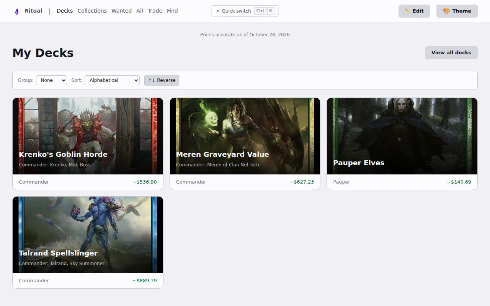

# Ritual


Ritual is a free, open-source command-line program for Magic: The Gathering. It keeps your decks, collections and wanted lists as plain markdown files in a folder, usually a git repository. It prices them, imports them from the sites you already use, and builds them into a website you can host anywhere.

- **Lists are files.** One markdown file per deck, collection or wanted list. Edit it with Ritual (`ritual edit` in the terminal, `ritual admin` in the browser) or by hand. Ritual logs the changes it makes in a history file beside the list, and keeps a small `.sha256` file there too so it can tell its own edits from yours; commit both with the list.
- **Prices.** TCGplayer, Cardmarket, Card Kingdom and Cardhoarder prices for every list. Card data and most prices come from a local cache of Scryfall's data; Card Kingdom's come from its own price list.
- **Import and sync.** Decks from Archidekt, Moxfield and MTGGoldfish, lists from text and CSV files, and two-way sync with Archidekt for decks and your collection.
- **Your own site.** `ritual build-site` writes a static website of your lists; `ritual init-site` sets up publishing to GitHub Pages. An MCP server and agent skills let AI assistants work with your lists too.

<picture>
  <source media="(prefers-color-scheme: dark)" srcset="docs-site/src/assets/screenshots/home-dark.webp" />
  
</picture>

See a built site in the [live demo](https://ritual.rpeters.dev/demo/), and read the documentation at <https://ritual.rpeters.dev/>.

## Install

On macOS or Linux:

```bash
curl -fsSL https://raw.githubusercontent.com/sloshy/ritual/main/scripts/install.sh | bash
```

On Windows (PowerShell):

```powershell
irm https://raw.githubusercontent.com/sloshy/ritual/main/scripts/install.ps1 | iex
```

Then run `ritual --help`. Prereleases, release binaries and building from source are covered on the [install page](https://ritual.rpeters.dev/start/install/), and the [quick tour](https://ritual.rpeters.dev/start/tour/) shows what to do next.

## License and Attribution

Ritual is free software under the [GNU Affero General Public License v3](LICENSE). See [NOTICE](NOTICE) for the full attribution.

Ritual is unofficial Fan Content permitted under the [Fan Content Policy](https://company.wizards.com/en/legal/fancontentpolicy). Not approved or endorsed by Wizards of the Coast. Portions of the materials used are property of Wizards of the Coast. ©Wizards of the Coast LLC. Card data, images and symbols come from [Scryfall](https://scryfall.com), which is not affiliated with this project.

## Contributing

See [CONTRIBUTING.md](CONTRIBUTING.md) for how to build Ritual from source, run the tests, and send changes.
